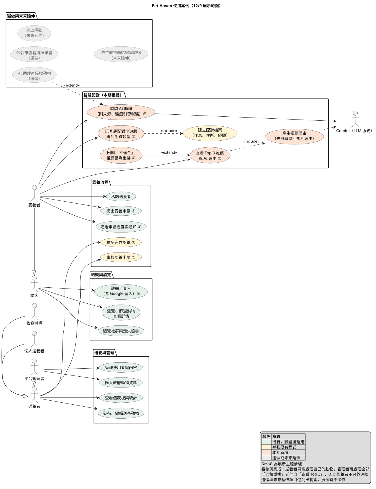
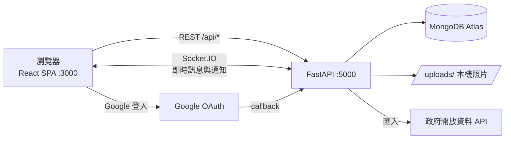
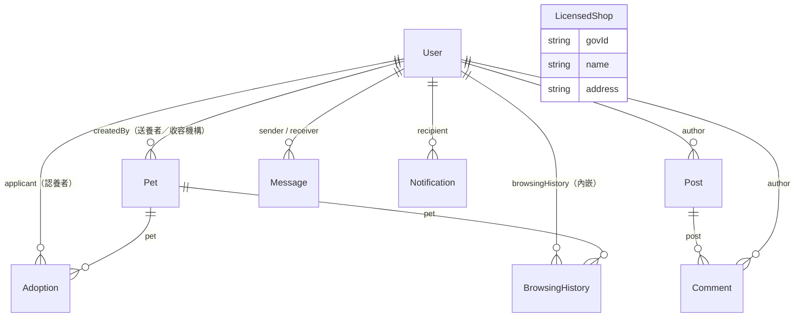
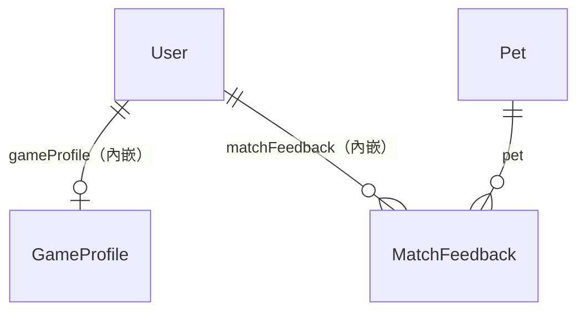
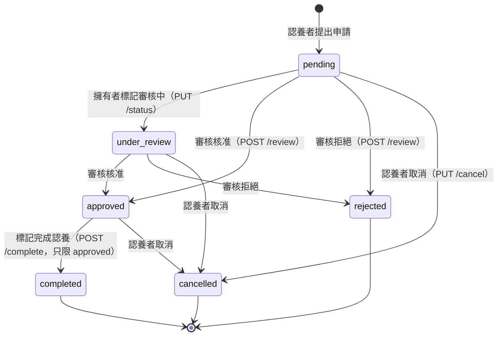

# Pet Haven 現況架構

- **用途**：記錄 `dev` 分支的系統，也是任務 03（架構、流程與資料模型）的產出：既有部分加上本期新增的欄位（§3.1）、API（§4.1）與流程。
- **整理方式**：依 FastAPI 版程式碼整理（2026-11-25 後端搬遷完成後更新）；同日已在本機啟動前後端並跑過後端 pytest。如與實際行為不符，以程式為準，並回頭修正本文件。
- **相關文件**：[需求與展示範圍](../superpowers/specs/2026-11-25-需求與展示範圍-design.md)、[新增 API 契約](../api/新增API契約.md)、執行中的 Swagger（`http://localhost:5000/api-docs`）

---

## 0. 架構圖與使用案例圖（12/9 目標）

兩張圖的原始檔在 [diagrams/](diagrams/)，顏色意義相同：綠＝既有、黃＝補強、橘＝本期新增、灰＝選做或未來延伸；T 編號對應需求文件的任務編號。

| 圖 | 原始檔 | 用途 |
|---|---|---|
| 系統架構圖 | [system-architecture.puml](diagrams/system-architecture.puml) | 前端、後端、資料庫、外部服務的關係，以及本期新增的元件放在哪裡 |
| 使用案例圖 | [use-case.puml](diagrams/use-case.puml) | 誰能做什麼，展示主線①～⑧分別對應哪個使用案例 |




**修改方式**：改 `.puml` 後要重新輸出 `.svg`，兩個檔案一起 commit，因為 GitHub 不會直接渲染 `.puml`。

- VS Code：安裝 PlantUML 擴充套件（jebbs.plantuml），在 `.puml` 檔按 `Alt+D` 預覽，再用「Export Current Diagram」輸出 SVG。
- 命令列（需要 Java 11 以上）：`java -jar plantuml.jar -charset UTF-8 -tsvg docs/architecture/diagrams/*.puml`
- 圖檔使用 `!pragma layout smetana`，不需要另外安裝 Graphviz。

---

## 1. 技術組成

| 層 | 技術 | 位置 |
|---|---|---|
| 前端 | React 18（Create React App）、React Router 6、Tailwind CSS 3、axios、socket.io-client | `frontend/` |
| 後端 | Python、FastAPI、PyMongo（async）、python-socketio、JWT（PyJWT）、bcrypt；已從舊 Node.js 版完整搬遷，§3 起的 model 與 API 說明仍適用（路徑與欄位相同） | `backend/`（新）、`backend-legacy/`（舊，只供參考） |
| 資料庫 | MongoDB Atlas | 連線字串放在 `backend/.env` 的 `MONGODB_URI`，資料庫名稱放在 `MONGODB_DB` |
| API 文件 | Swagger（FastAPI 自動產生） | 執行中可開 `http://localhost:5000/api-docs` |
| 測試 | pytest（後端）、Playwright（e2e） | `backend/tests/`、`frontend/e2e/` |
| CI | GitHub Actions：後端 pytest 與 FastAPI 就緒檢查，main、dev 的 push 和 PR 都會觸發（尚未包含 e2e） | `.github/workflows/integration-tests.yml` |

開發時，前端（:3000）透過 `frontend/src/setupProxy.js` 把 API 請求轉給後端（:5000）。



## 2. 目錄地圖

```
backend/           FastAPI（新）
  app/main.py      進入點：建立 app、CORS、註冊 router、連線 MongoDB、掛上 Socket.IO
  app/routers/     API 路由（一個資源一個檔，見 §4）
  app/models/      各 collection 的欄位定義與輸出格式（見 §3）
  app/services/    advanced_matching.py（規則配對）、recommendation.py（熱門推薦）、gov_data.py（政府資料）
  app/core/        共用：JWT 與密碼、輸入驗證、序列化、上傳、速率限制、log
  app/deps.py      current_user／optional_user／require_roles（登入與角色檢查）
  app/realtime.py  Socket.IO（連線驗證 JWT，emit_to_user 推送）
  app/db.py        資料庫連線與 get_db()
  app/config.py    環境變數設定
  tests/           pytest 單元測試
  uploads/         上傳的照片（不進 git）
backend-legacy/    舊 Node.js 後端（只供搬遷參考）
  server.js        進入點：middleware、路由掛載、Socket.IO、MongoDB 連線
  routes/          16 個路由檔，對應 /api/*（見 §4）
  models/          9 個 Mongoose model（見 §3）
  services/        advancedMatchingService.js（規則配對）、recommendationService.js（熱門推薦）
  middleware/      auth.js（JWT）、roleCheck.js（角色）、validation.js
  config/          swagger 設定
  scripts/         資料修補與匯入腳本（如 import-moa-licensed-shops.js）
  tests/           jest 單元測試
frontend/src/
  App.js           路由表
  pages/           26 個頁面
  components/      共用元件（含 MatchAnalysisPanel、RecommendationSection、ProfileSettingsForm）
  services/        API 呼叫、AuthProvider、SocketProvider
frontend/e2e/      Playwright 測試
docs/              專案文件（索引見 docs/README.md）
```

## 3. 資料模型

每個欄位的型別、可用值、預設值與索引見 [資料庫結構](資料庫結構.md)；本節只列關係與重點欄位。



| Model | 用途 | 與配對、展示主線相關的欄位 |
|---|---|---|
| `User` | 使用者 | `role`：`user`／`shelter`／`admin`；配對檔案 `lifestyleProfile`、`experienceProfile`、`environmentProfile`；`recommendationProfile`、`preferences`；`favorites`、`browsingHistory` |
| `Pet` | 動物 | `species`、`size`、`age`、`personality`（含 `activityLevel`、`goodWith`、`specialNeeds`）、`healthStatus`、`adoptionStatus`、`shelterInfo`（政府資料來源）、`externalLink`（外部助養連結）、`createdBy` |
| `Adoption` | 認養申請 | `status`：`pending`／`under-review`／`approved`／`rejected`／`completed`／`cancelled`（轉換見 §5.2）；`applicantDetails`、`reviewNotes`、`reviewDecision`、`completionInfo`、`followUp` |
| `Message` | 私訊 | `sender`、`receiver`、`conversationId`、`relatedPet`、`relatedAdoption` |
| `Notification` | 通知 | `recipient`、`type`、`relatedPet`、`relatedAdoption`、`isRead` |
| `Post` | 社群貼文、走失協尋 | `type`、`category`、`lostPetInfo`、`relatedPets` |
| `Comment` | 留言 | `post`、`author`、`parentComment` |
| `User.browsingHistory` | 瀏覽紀錄（推薦用），內嵌在 User；舊版獨立的 `browsinghistories` collection 已不使用 | `pet`、`viewedAt`；最新在前，最多 50 筆 |
| `LicensedShop` | 政府持照寵物業者 | `govId`、`name`、`address`、`businessItem`（目前沒有前台頁面使用） |

### 3.1 本期新增的欄位（任務 03 產出）

只新增兩個 `User` 欄位，其他 model 不動。詳細格式見 [新增 API 契約](../api/新增API契約.md) 附錄。

| Model | 新欄位 | 內容 | 寫入者 |
|---|---|---|---|
| `User` | `gameProfile`（預設 `null`） | 8 題遊戲的原始答案 `answers`、毛孩類型 `petType`、`completedAt` | `PUT /api/matching/profile/game`（T10） |
| `User` | `matchFeedback`（預設 `[]`） | 「適合／不適合」回饋 `[{ pet, verdict, createdAt }]`，同一隻動物只留最新一筆 | `POST`／`DELETE /api/matching/feedback`（T13） |

- **遊戲答案換算後的配對欄位**仍寫進既有的 `lifestyleProfile`、`experienceProfile`、`environmentProfile`，不另開欄位；遊戲和個人檔案表單以最後一次寫入為準。
- **AI 理由不存資料庫**：每次呼叫 Top 3 或 `/api/ai/explain` 時即時產生，失敗時改用規則理由。



## 4. API 路由

路由在 `backend/app/main.py` 的 `ROUTERS` 註冊，一個資源一個檔，在 `backend/app/routers/`。路徑與回應格式和舊 Node 版相同。詳細的輸入輸出請看 Swagger。

| 前綴 | 檔案 | 主要功能 |
|---|---|---|
| `/api/health`、`/api/ready` | `health.py` | 健康檢查；`/ready` 會檢查資料庫連線 |
| `/api/auth` | `auth.py` | 註冊、登入、`/me`、`/profile`、`/change-password`、`/verify-token`、Google 登入（`/google`、`/google/callback`、`/google/verify`）。登入失敗有速率限制 |
| `/api/pets` | `pets.py` | 動物列表與篩選、詳情、新增、編輯、刪除、按讚、`/my-pets`、精選、統計、`/{id}/sponsorship/click` |
| `/api/adoptions` | `adoptions.py` | 申請（`/`、`/apply/{petId}`）、`/my-applications`、`/my-pets-applications`、`/{id}/status`、`/{id}/complete`、`/{id}/cancel`、`/{id}/review`、`/{id}/notes`、管理統計 |
| `/api/matching` | `matching.py` | 配對分析 `/analyze/{petId}`、`/best-matches`、`/batch-analyze`、配對檔案 `/profile`、`/profile/lifestyle`、`/profile/experience`、`/profile/environment` |
| `/api/recommendations` | `recommendations.py` | 個人化推薦，未登入時改推熱門；`/refresh` |
| `/api/browsing-history` | `browsing_history.py` | 記錄、查詢、清除瀏覽紀錄 |
| `/api/users` | `users.py` | 使用者管理、`/me/stats`、`/me/activities`、收藏 |
| `/api/stats`、`/api/shelters/{id}/stats` | `stats.py` | 首頁公開統計、收容所儀表板統計 |
| `/api/messages`、`/api/notifications` | `messages.py`、`notifications.py` | 私訊、通知 |
| `/api/posts`、`/api/comments` | `posts.py`、`comments.py` | 社群、走失協尋、留言 |
| `/api/data-import` | `data_import.py` | 政府動物資料查詢與匯入、持照寵物業者查詢 |

舊版的 `/api/debug`（通知除錯）依搬遷規格不搬。

### 4.1 本期新增的 API（尚未實作）

格式、權限、錯誤與 AI 規則都定在 [新增 API 契約](../api/新增API契約.md)（定稿 v1）。

| 方法與路徑 | 任務 | 用途 |
|---|---|---|
| `PUT /api/matching/profile/game` | T10 | 保存遊戲答案與毛孩類型 |
| `GET /api/matching/top3` | T13 | 硬條件篩選＋既有計分＋回饋重排，取前 3 名並附理由 |
| `POST`／`DELETE /api/matching/feedback` | T13 | 「適合／不適合」回饋；不適合時直接回傳重排後的 Top 3 |
| `POST /api/ai/chat` | T12、T14 | 檢索知識庫後由 Gemini 回答，附來源；醫療問題拒答 |
| `POST /api/ai/explain` | T12 | 為一隻動物產生推薦理由，失敗時改用規則理由 |

## 5. 主要流程

### 5.1 登入與權限

1. 帳密登入（`POST /api/auth/login`）或 Google 登入（`/api/auth/google/callback` → 前端 `/auth/callback`）。
2. 後端簽發 JWT（PyJWT），前端在 `Authorization: Bearer <token>` 標頭帶上。
3. `app/deps.py` 的 `current_user`（必須登入）、`optional_user`（可不登入）驗證 token；`require_roles(...)` 檢查角色。修改資源前，路由內再確認是不是擁有者，`admin` 例外。
4. Socket.IO 連線時也要帶 JWT（`app/realtime.py`），只能加入自己的房間。

### 5.2 認養申請



圖中的 `under_review` 是程式裡的 `under-review`（Mermaid 狀態名稱不能有 `-`）。

| 申請狀態變成 | 動物 `adoptionStatus` 跟著變成 | 通知誰 |
|---|---|---|
| `approved` | `pending` | 認養者 |
| `rejected` | `available`（見下方例外） | 認養者 |
| `completed` | `adopted` | 認養者；同一隻其他進行中的申請一併結束，通知那些申請人 |
| `cancelled` | `available`（見下方例外） | 動物擁有者 |

- **動物狀態的例外（2026-11-27）**：動物已是 `adopted` 時不能再核准申請；拒絕或取消留下的舊申請只關閉申請，動物維持 `adopted`。同一隻動物還有其他進行中（`pending`／`under-review`／`approved`）的申請時，拒絕或取消其中一份不會把動物改回 `available`。程式在 `adoptions.py` 的 `_sync_pet_status`。
- **完成認養時結束其他申請（2026-11-27）**：`POST /{id}/complete`（以及 `PUT /{id}/status` 改成 `completed`）會把同一隻動物其他進行中的申請改為 `rejected`，原因寫「這隻動物已由其他認養人完成認養」，並以「認養申請已結束」通知申請人；回應多回傳 `closedApplications`（結束的筆數）。正常流程下動物收到申請後就不能再申請，所以通常是 0，主要處理舊資料。

- **權限（任務 07，已完成）**：`PUT /{id}/status`、`POST /{id}/complete`、`POST /{id}/review`、`POST /{id}/notes` 都用 `can_manage_adoption` 判斷：動物的擁有者（收容機構或個人送養者）或 `admin` 才能操作。測試在 `backend/tests/test_adoptions.py`（主線流程與越權案例）。
- 通知由 `app/models/notification.py` 建立，並透過 Socket.IO 推送到收件者的房間（房間以 userId 命名）。

### 5.3 配對與推薦

- **規則配對**（`app/services/advanced_matching.py`）：從相容性、生活型態、經驗、居住環境四個面向計分，再加權得出總分，同時產生優點、注意事項、建議；前端由 `MatchAnalysisPanel` 顯示。
- **熱門推薦**（`app/services/recommendation.py`）：依熱門程度與資料新鮮度計分；未登入或沒有偏好時使用。
- **本期新增**：小遊戲寫入配對欄位 → `GET /top3` 用硬條件篩選、沿用規則配對計分、依「不適合」回饋重排 → Gemini 依真實欄位產生理由（失敗時改用規則理由）。規則見[新增 API 契約](../api/新增API契約.md) §0。

### 5.4 政府資料匯入

`/api/data-import` 呼叫政府開放資料 API 並寫入 `Pet`，原收容所資訊保留在 `shelterInfo`，以來源識別碼避免重複匯入。持照寵物業者寫入 `LicensedShop`（腳本：`backend/scripts/import_licensed_shops.py`）。

## 6. 已知缺口

2026-11-25 已處理：`/api/pets/featured` 被 `/:id` 攔截（已調整路由順序）、`/api/debug` 沒有權限檢查（依搬遷規格不搬）、收容機構不能改申請狀態與標記完成（任務 07，在後端搬遷時完成）。

| 缺口 | 影響 | 處理 |
|---|---|---|
| ~~沒有 LLM、配對小遊戲、回饋紀錄、Top 3~~ | 本期新增，展示主線②③④ | 2026-11-27 已完成：遊戲結果 API、Top 3 與回饋、AI 理由、聊天 API、知識庫初版（38 則）、推薦頁與聊天視窗；知識庫來源待組內審核，e2e 待用測試帳號執行 |
| `PUT /{id}/status` 不檢查狀態轉換順序（例如可以把 `completed` 改回 `pending`） | 只有擁有者和 `admin` 能用，展示主線不受影響 | 任務 18 驗收時決定是否限制 |
| 認養者可以取消已被拒絕（`rejected`）的申請 | 不影響主線 | 任務 18 驗收時決定是否限制 |
