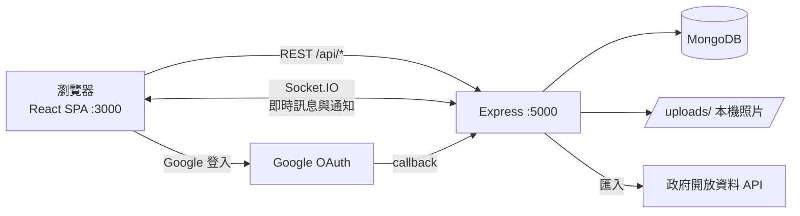
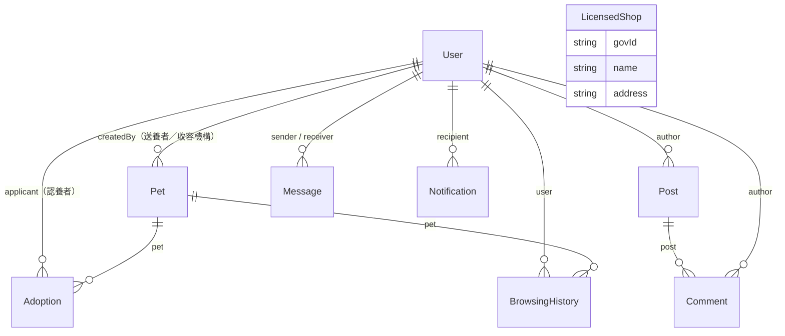
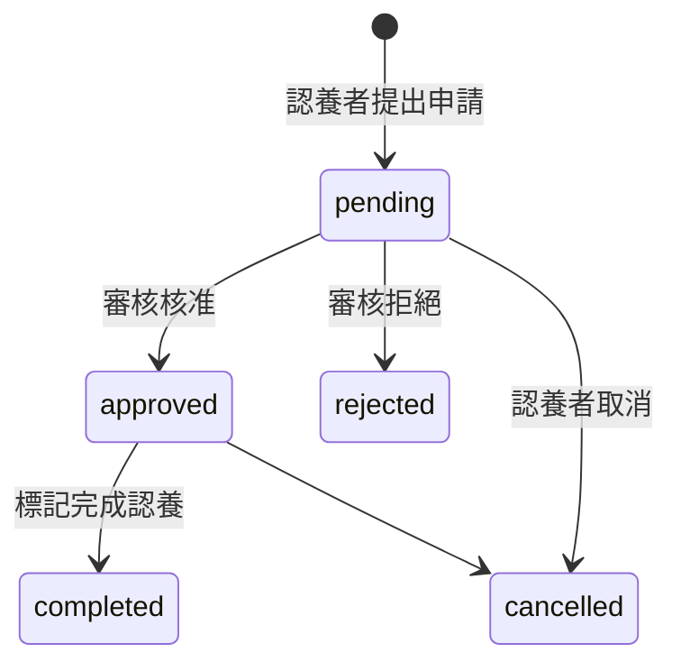

# Pet Haven 現況架構

- **用途**：記錄 2026-11-25 時 `dev` 分支已有的系統，作為任務 03（架構、流程與資料模型）的起點；任務 03 只需補上本期新增的部分。
- **整理方式**：依程式碼靜態整理，尚未實機驗證。如與實際行為不符，以程式為準，並回頭修正本文件。
- **相關文件**：[需求與展示範圍](../superpowers/specs/2026-11-25-需求與展示範圍-design.md)、[API 文件說明](../../backend/SWAGGER_API_DOCS.md)

---

## 1. 技術組成

| 層 | 技術 | 位置 |
|---|---|---|
| 前端 | React 18（Create React App）、React Router 6、Tailwind CSS 3、axios、socket.io-client | `frontend/` |
| 後端 | Node.js、Express 4、Mongoose 7、Socket.IO 4、Passport（Google OAuth）、JWT、multer | `backend/` |
| 資料庫 | MongoDB | 連線字串放在 `backend/.env` 的 `MONGODB_URI` |
| API 文件 | Swagger（`swagger-ui-express`） | 執行中可開 `http://localhost:5000/api-docs` |
| 測試 | jest（後端）、Playwright（e2e） | `backend/tests/`、`frontend/e2e/` |
| CI | GitHub Actions 整合測試，main、dev 的 push 和 PR 都會觸發（尚未包含 jest 單元測試與 e2e） | `.github/workflows/integration-tests.yml` |

開發時，前端（:3000）透過 `frontend/src/setupProxy.js` 把 API 請求轉給後端（:5000）。



## 2. 目錄地圖

```
backend/
  server.js        進入點：middleware、路由掛載、Socket.IO、MongoDB 連線
  routes/          16 個路由檔，對應 /api/*（見 §4）
  models/          9 個 Mongoose model（見 §3）
  services/        advancedMatchingService.js（規則配對）、recommendationService.js（熱門推薦）
  middleware/      auth.js（JWT）、roleCheck.js（角色）、validation.js
  config/          swagger 設定
  scripts/         資料修補與匯入腳本（如 import-moa-licensed-shops.js）
  tests/           jest 單元測試
  uploads/         上傳的照片（不進 git）
frontend/src/
  App.js           路由表
  pages/           26 個頁面
  components/      共用元件（含 MatchAnalysisPanel、RecommendationSection、ProfileSettingsForm）
  services/        API 呼叫、AuthProvider、SocketProvider
frontend/e2e/      Playwright 測試
docs/              專案文件（索引見 docs/README.md）
.bmad-core/        之前使用 BMAD 開發框架留下的設定（程式註解中的「Story x.x」出自此）
```

## 3. 資料模型



| Model | 用途 | 與配對、展示主線相關的欄位 |
|---|---|---|
| `User` | 使用者 | `role`：`user`／`shelter`／`admin`；配對檔案 `lifestyleProfile`、`experienceProfile`、`environmentProfile`；`recommendationProfile`、`preferences`；`favorites`、`browsingHistory` |
| `Pet` | 動物 | `species`、`size`、`age`、`personality`（含 `activityLevel`、`goodWith`、`specialNeeds`）、`healthStatus`、`adoptionStatus`、`shelterInfo`（政府資料來源）、`externalLink`（外部助養連結）、`createdBy` |
| `Adoption` | 認養申請 | `status`：`pending`／`approved`／`rejected`／`completed`／`cancelled`；`applicantDetails`、`reviewNotes`、`reviewDecision`、`completionInfo`、`followUp` |
| `Message` | 私訊 | `sender`、`receiver`、`conversationId`、`relatedPet`、`relatedAdoption` |
| `Notification` | 通知 | `recipient`、`type`、`relatedPet`、`relatedAdoption`、`isRead` |
| `Post` | 社群貼文、走失協尋 | `type`、`category`、`lostPetInfo`、`relatedPets` |
| `Comment` | 留言 | `post`、`author`、`parentComment` |
| `BrowsingHistory` | 瀏覽紀錄（推薦用） | `user`、`pet`、`viewedAt`、`duration` |
| `LicensedShop` | 政府持照寵物業者 | `govId`、`name`、`address`、`businessItem`（目前沒有前台頁面使用） |

## 4. API 路由

路由掛載在 `backend/server.js`。詳細的輸入輸出請看 Swagger。

| 前綴 | 檔案 | 主要功能 |
|---|---|---|
| `/api/auth` | `auth.js` | 註冊、登入、`/me`、修改資料與密碼、Google 登入（`/google`、`/google/callback`、`/google/verify`）。有獨立的速率限制 |
| `/api/pets` | `pets.js` | 動物列表與篩選、詳情、新增、編輯、刪除、按讚、`/my-pets`、精選、統計、`/:id/sponsorship/click` |
| `/api/adoptions` | `adoptions.js` | 申請（`/`、`/apply/:petId`）、`/my-applications`、`/my-pets-applications`、`/:id/status`、`/:id/complete`、`/:id/cancel`、`/:id/review`、`/:id/notes`、管理統計 |
| `/api/matching` | `matching.js` | 配對分析 `/analyze/:petId`、`/best-matches`、`/batch-analyze`、配對檔案 `/profile`、`/profile/lifestyle`、`/profile/experience`、`/profile/environment` |
| `/api/recommendations` | `recommendations.js` | 個人化推薦，未登入時改推熱門；`/refresh` |
| `/api/browsing-history` | `browsing-history.js` | 記錄、查詢、清除瀏覽紀錄 |
| `/api/users` | `users.js`、`user-stats.js` | 使用者管理、使用者儀表板統計 |
| `/api/shelters` | `shelters.js` | 收容所儀表板 |
| `/api/messages`、`/api/notifications` | `messages.js`、`notifications.js` | 私訊、通知 |
| `/api/posts`、`/api/comments` | `posts.js`、`comments.js` | 社群、走失協尋、留言 |
| `/api/stats` | `stats.js` | 首頁公開統計 |
| `/api/data-import` | `data-import.js` | 政府動物資料查詢與匯入、持照寵物業者查詢 |
| `/api/debug` | `debug-notifications.js` | 通知除錯用。註解寫「僅在 development 啟用」，但實際上不論環境都會掛載（見 §6） |

## 5. 主要流程

### 5.1 登入與權限

1. 帳密登入（`POST /api/auth/login`）或 Google 登入（Passport → `/api/auth/google/callback` → 前端 `/auth/callback`）。
2. 後端簽發 JWT，前端在 `Authorization` 標頭帶上 token。
3. `middleware/auth.js` 驗證 token；`middleware/roleCheck.js` 或各路由內的 `requireAdmin` 檢查角色。

### 5.2 認養申請



- 狀態變更時會建立 `Notification`。推送邏輯寫在 `models/Notification.js`，用 Socket.IO 送到收件者的房間（房間以 userId 命名）。
- **現況權限**：`PUT /:id/status` 和 `POST /:id/complete` 只開放 `admin`；`POST /:id/review` 會檢查是否為該動物的擁有者。任務 07 會補強前兩者。

### 5.3 配對與推薦

- **規則配對**（`advancedMatchingService.js`）：從相容性、生活型態、經驗、居住環境四個面向計分，再加權得出總分，同時產生優點、注意事項、建議；前端由 `MatchAnalysisPanel` 顯示。
- **熱門推薦**（`recommendationService.js`）：依熱門程度與資料新鮮度計分；未登入或沒有偏好時使用。

### 5.4 政府資料匯入

`/api/data-import` 呼叫政府開放資料 API 並寫入 `Pet`，原收容所資訊保留在 `shelterInfo`，以來源識別碼避免重複匯入。持照寵物業者寫入 `LicensedShop`（另有 `backend/scripts/import-moa-licensed-shops.js`）。

## 6. 已知缺口（靜態檢查發現，待任務 01 實機確認）

| 缺口 | 影響 | 處理 |
|---|---|---|
| 收容機構不能改申請狀態、不能標記完成 | 展示主線⑥⑦做不到 | 任務 07 |
| 沒有 Docker 設定 | 無法依計畫建立本機展示環境 | 任務 20 |
| 照片存在本機 `uploads/` | 容器重建後會遺失 | 任務 20 用 volume 保存 |
| `pets.js` 的 `GET /:id`（第 414 行）定義在 `GET /featured`（第 829 行）之前 | `/api/pets/featured` 可能被當成 id 處理，進不了精選路由 | 待實機確認 |
| `/api/debug` 不論環境都會掛載（`server.js` 約第 251 行） | 展示環境也能存取除錯路由 | 任務 07 檢查其權限，或改為只在 development 掛載 |
| 沒有 LLM、配對小遊戲、回饋紀錄 | 本期新增 | 任務 10 到 15 |
